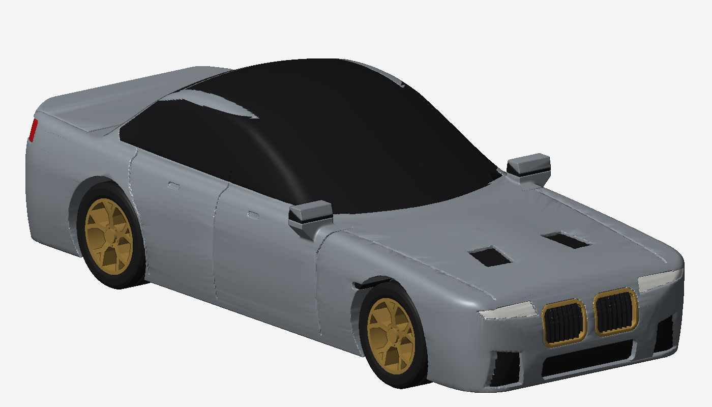
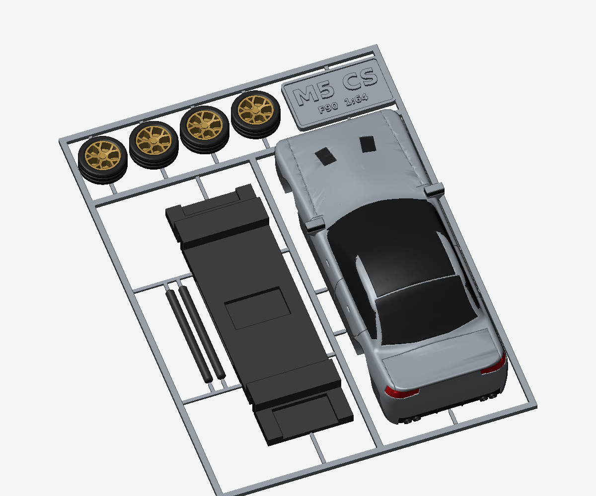
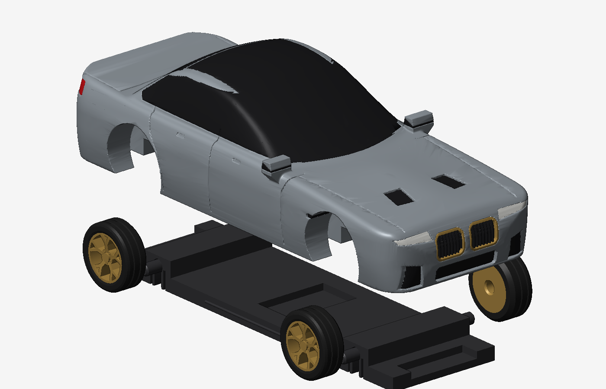

# Twisted textured lamp (Blender)

Run `lamp_blender.py` in Blender (Scripting tab > Open > Run Script) or headless:
`blender -b -P lamp_blender.py -- ./stl`

Parts (mm): `lamp_shade.stl`, `lamp_base.stl`, `lamp_cap.stl` (already generated in `stl/`).
All dimensions are parameters at the top of the script.

Print notes
- Shade: upright, no supports, 0.4 mm nozzle, 0.2 mm layers, 2-3 perimeters, 0% infill, white/natural PLA or PETG (translucent). Prefer a cool LED bulb (PLA softens ~60 C).
- Base: upright. Cap: flat on the bed. 4 x M3x16 screws (self-tapping in 2.6 mm pilot holes).
- E14 holder fits the 36 mm hole (set `SOCKET_HOLE` for E27). Cable exits through the side slot.
- Set `TEXTURE = False` for a light, smooth shade.

# Ribbed jar with bayonet lid (`jar_blender.py`)

Open: align the lid ribs with the lug marks, push down, turn **30 deg clockwise** to lock; reverse to open.
Mechanism checked by boolean interference tests: lid drops straight when aligned, turns freely over 30 deg,
hard stop at the end, cannot be lifted once locked. Tune `TWIST_DEG`, `CLEARANCE` for your printer.

# BMW M5 CS (F90) 1:64 snap kit (`m5cs_generator.py`)

Kit card in the style of the RolfBertz3D E46 GTR: one plate, **no supports, no glue**.
Ready to slice: `BMW_M5_CS_F90.3mf` (Bambu Studio / Orca / Creality Print), or the STLs in `stl/m5cs_*.stl`.

| Plate | Exploded |
|---|---|
|  |  |

Parts: solid body (pocket underneath), chassis with 2 snap-in axle channels, 2 axles, 4 Y-spoke wheels
(rim + tyre volumes), sprue frame with an "M5 CS" tag. Plate footprint 75 x 104 mm, body 78 x 32 x 21 mm.

Assembly
1. Snap the parts off the frame, clean the gate nubs (keep the axle ends clean).
2. Press a wheel onto one axle end (the wheel is a press fit, the axle turns in the chassis).
3. Click the axle up into its chassis channel, press the second wheel on.
4. Push the chassis up into the body until the side ridges click into the pocket grooves.

Multi-colour (optional): the body object holds 5 volumes already assigned to filaments
1 grey paint, 2 black (glass, carbon roof, grilles, diffuser, tyres, chassis), 3 gold bronze (rims, kidney surround),
4 red (tail lights), 5 white (headlights). For one colour, set every part to the same filament.

Print notes: 0.4 mm nozzle, 0.12-0.16 mm layers for the body, 3 walls, 15 % infill. Textured PEI helps the
small parts stick. Tune the fits at the top of the script: `PRESS_FIT` (wheel on axle), `AXLE_CLEAR`, `SNAP_MOUTH`
(axle click), `CHASSIS_CLEAR`, `RIDGE` (chassis click).

Regenerate (about 4 min, plain Python, no Blender):
`pip install numpy scipy scikit-image trimesh manifold3d matplotlib` then `python m5cs_generator.py`
(`--preview` for a fast coarse body).
